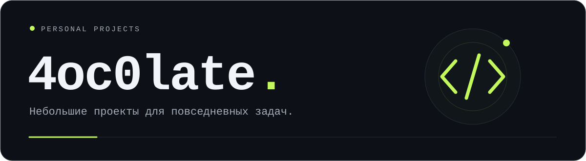
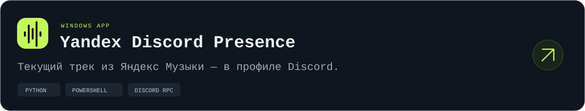

 

Здесь собираю свои проекты: приложения, небольшие инструменты и идеи, которые хочется довести до рабочего состояния.

### Проекты

**[Yandex Discord Presence](https://github.com/4oc0late/yandex-discord-presence)** — музыка из десктопного плеера в статусе Discord. Обложка, название трека, время воспроизведения и кнопка перехода к песне. Управление процессом и оформлением — в отдельном окне.

На паузе таймер останавливается. Через пять минут статус скрывается и возвращается, когда музыка снова играет.
